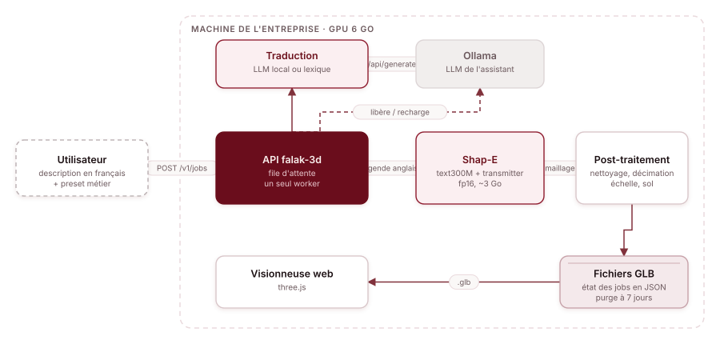

# Falak 3D

Génération d'objets 3D à partir d'une phrase, sur une carte graphique grand
public et sans service cloud. Le modèle est [Shap-E](https://github.com/openai/shap-e)
(OpenAI, open-source) ; ce dépôt en fait un service utilisable par une
entreprise : presets par métier, traduction des descriptions, maillages
nettoyés et mis à l'échelle, file de jobs, visionneuse web.

C'est le service derrière la galerie de [falakion.com/falak3d](https://falakion.com/fr/falak3d).



Le document complet est dans [docs/falak-3d.pdf](docs/falak-3d.pdf).

## Ce que le projet montre

- **Faire tourner un modèle génératif sur du matériel modeste.** La cible est
  une GTX 1060 de 6 Go (architecture Pascal) partagée avec le LLM de
  l'assistant. Le choix des versions de PyTorch, le cache des poids et le
  partage de la VRAM sont traités explicitement.
- **Adapter le modèle aux usages plutôt que l'inverse.** Un preset décrit un
  métier : gabarit de description, réglages de diffusion, budget de faces et
  taille réelle de l'objet. Le même modèle produit une maquette produit de
  35 cm, un accessoire de jeu low-poly ou un meuble à l'échelle.
- **Livrer un fichier utilisable, pas une sortie brute.** Le maillage est
  débarrassé de ses îlots, décimé en gardant ses couleurs, réorienté (Shap-E
  travaille en Z vers le haut, glTF en Y), mis à l'échelle et posé au sol.
- **Être exploitable.** File à un seul worker avec positions et annulation,
  état persistant, purge automatique, `/health` qui sait dire que le worker est
  mort, métriques Prometheus.

## Presets

| Preset | Usage | Faces | Taille |
|---|---|---|---|
| `ecommerce` | maquette de produit pour une fiche ou un configurateur | 20 000 | 35 cm |
| `packaging` | premier volume d'un emballage ou d'un présentoir | 8 000 | 25 cm |
| `jeu` | accessoire de décor low-poly pour un moteur temps réel | 2 500 | 1 m |
| `amenagement` | mobilier à l'échelle pour une esquisse d'espace | 15 000 | 1,2 m |

Un preset est un fichier YAML dans `presets/` : en ajouter un ne demande pas
de toucher au code.

## Démarrage

Avec Docker et un GPU NVIDIA :

```bash
cp .env.example .env
docker compose up -d --build
curl -X POST localhost:8001/v1/jobs -H "X-API-Key: $FALAK3D_API_KEY" \
  -H "Content-Type: application/json" \
  -d '{"prompt": "une lampe de bureau", "preset": "ecommerce"}'
```

Le premier job télécharge les poids (2,7 Go, gardés dans le volume) et les
charge en mémoire, environ 30 secondes. Une génération prend ensuite 40 à
60 secondes sur la GTX 1060.

Sans GPU, pour essayer l'API et la chaîne de traitement :

```bash
pip install -e .
falak3d generate "une tasse" --fake -o out/tasse.glb
```

Les fichiers `.glb` s'ouvrent dans `viewer/index.html` (glisser-déposer, ou
`?src=` suivi de l'URL du fichier).

## Traduction

Shap-E a été entraîné sur des légendes en anglais. Si `OLLAMA_URL` est défini,
la description est traduite par le LLM local ; sinon un petit lexique couvre
les objets courants. Avec Ollama configuré, le service décharge aussi le LLM
pendant une génération et le recharge quand la file se vide.

## API

| Méthode | Route | Rôle |
|---|---|---|
| `GET` | `/v1/presets` | liste des presets |
| `POST` | `/v1/jobs` | crée un job (`prompt`, `preset`) |
| `GET` | `/v1/jobs/{id}` | état, position dans la file, rapport de maillage |
| `POST` | `/v1/jobs/{id}/cancel` | annule un job en attente |
| `GET` | `/v1/files/{id}.glb` | fichier produit |
| `GET` | `/health`, `/metrics` | supervision |

## Tests

```bash
pip install -e ".[dev]"
pytest
```

Les tests utilisent un générateur de primitives à la place de Shap-E : ils
couvrent le traitement des maillages, la file et l'API sans GPU.

## Licence

MIT. Shap-E est distribué sous licence MIT par OpenAI.
